# aequalyn-shell

The Aequalyn desktop shell, written in QML for [Quickshell](https://quickshell.org)
on Hyprland: a shaped top bar, up to 16 docks, launcher, notifications, OSD, clipboard history,
display manager, power menu, settings and **Atelier**.

Installed to `~/.config/quickshell` by [aequalyn](https://github.com/Aequalyn/aequalyn)'s
`install.sh`, which also provides the `aequalyn-*` commands the shell calls.

## Atelier

One picker for everything that sets the look of the desktop.

| | |
| --- | --- |
| **Themes** | Folder themes (palette + backgrounds), wallpaper colours and 200+ curated palettes. The whole shell previews the theme under the cursor. |
| **Wallpapers** | Images, videos, theme backgrounds and painted wallpapers, filterable and searchable. |
| **Layouts** | 37 window layouts as pictures: pick one for any workspace, choose which ones Super + L goes through, set the main pane and gap. |
| **Rotation** | Static, theme set, slideshow, time of day, per workspace or live video; transitions; monitors; painting a wallpaper from the palette. |
| **Palette** | Wallpaper or fixed colours, lock, dark / light / auto, matugen scheme, contrast. |
| **Bar** | Band, Pill, Isles or Pebbles; 26 looks in five families; 8 ensembles that dress the bar and every dock at once; placement, hover, separators, colours and every part (ends, surface, lines, ornaments). |
| **Docks** | Up to 16 docks, 4 per edge of each screen: apps, edge, size, 8 auto-hide effects, and the bar's look or one of 16 of their own, for one dock, its edge or all. |
| **Panel** | Open as a docked panel, a window or full screen; what the bar buttons do. |

Themes and Wallpapers each have six layouts, remembered per collection:

| Grid | Carousel | Filmstrip |
| --- | --- | --- |
| 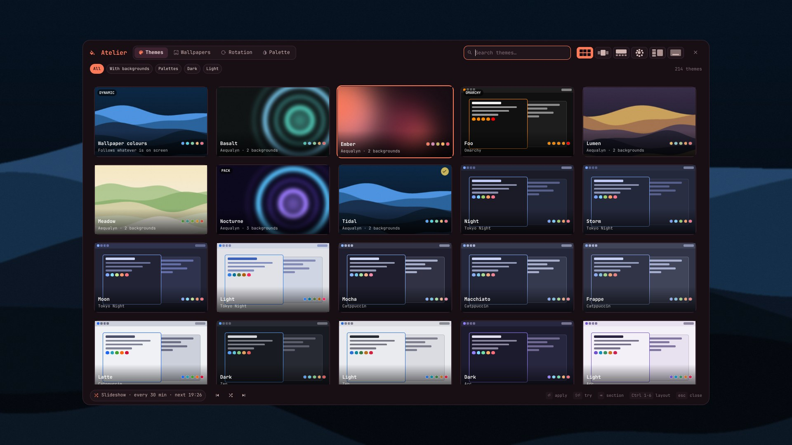 | 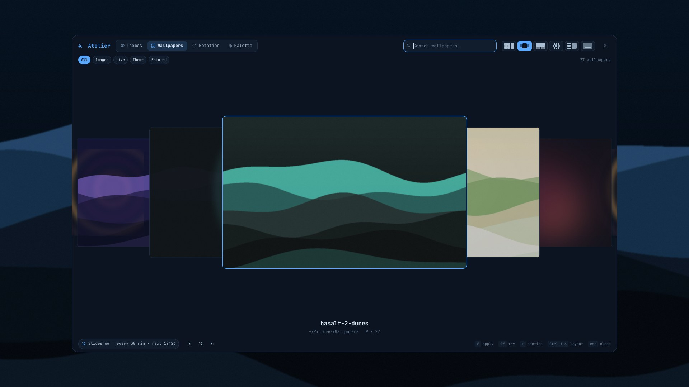 | 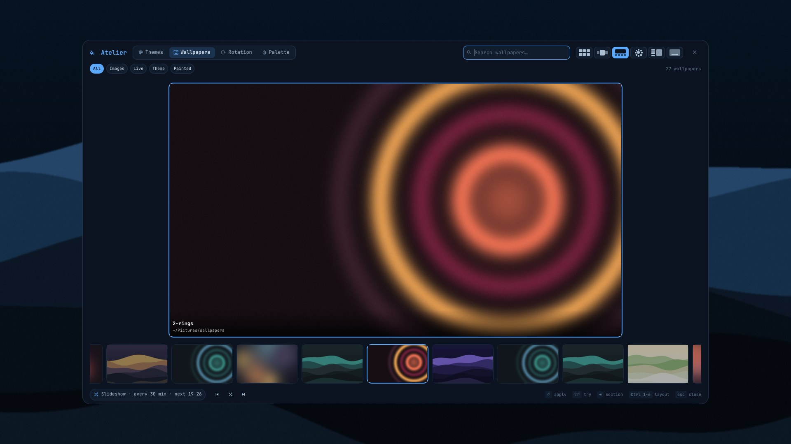 |
| **Radial** | **List** | **Spotlight** |
| 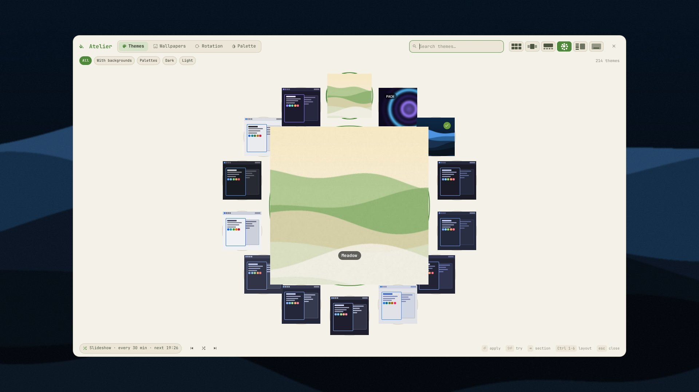 | 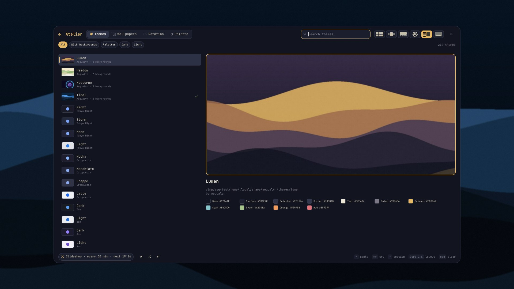 | 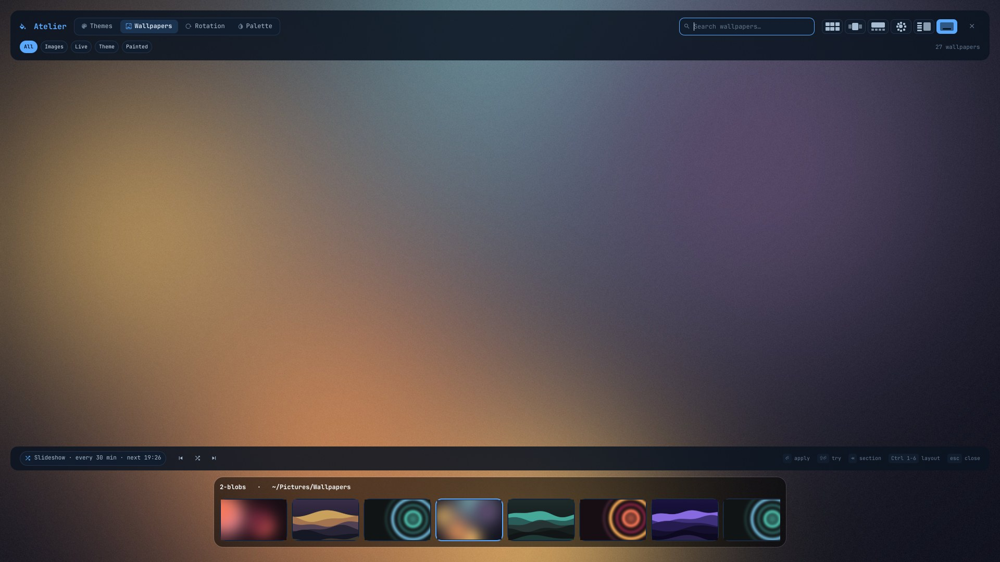 |

| Layouts | Rotation | Palette |
| --- | --- | --- |
| 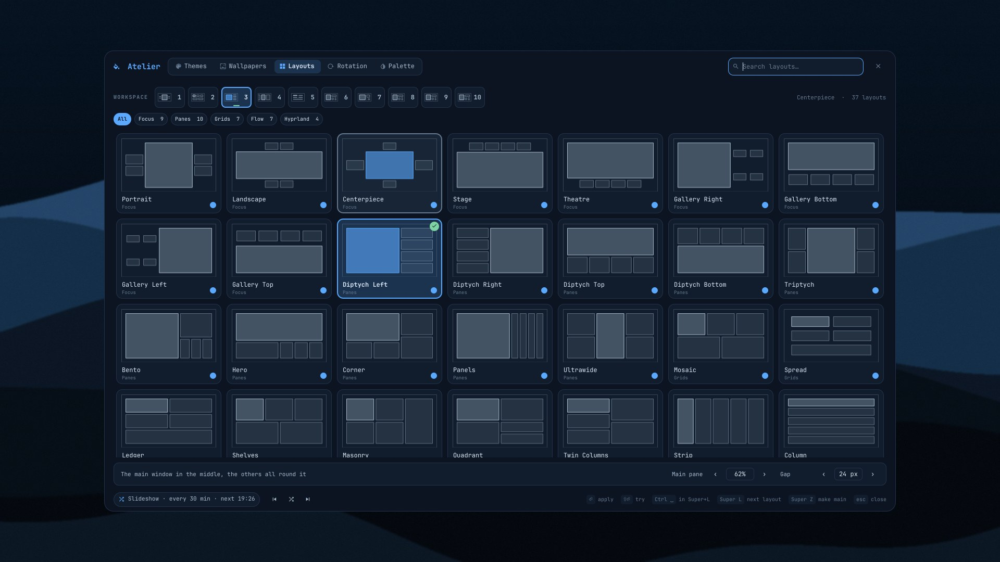 | 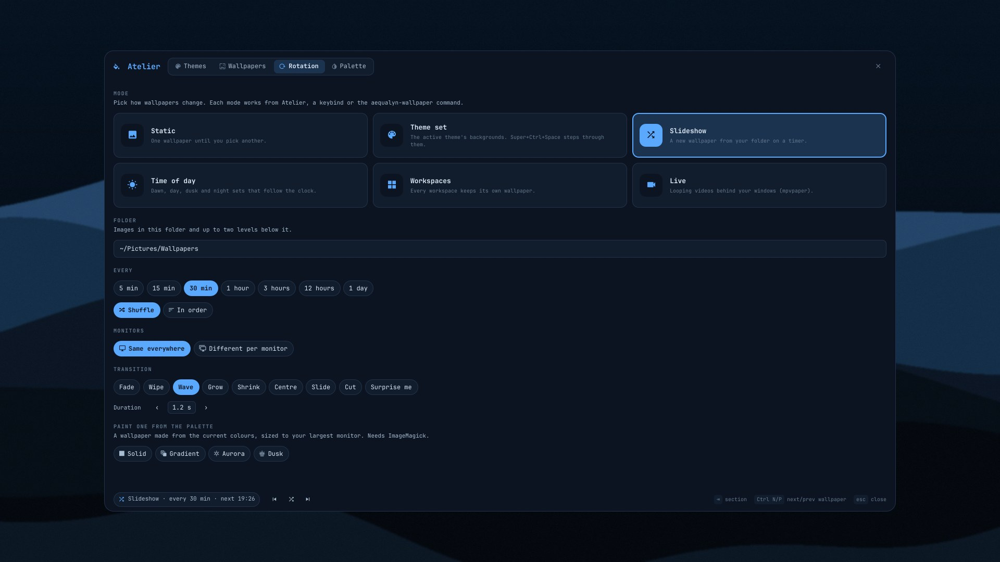 | 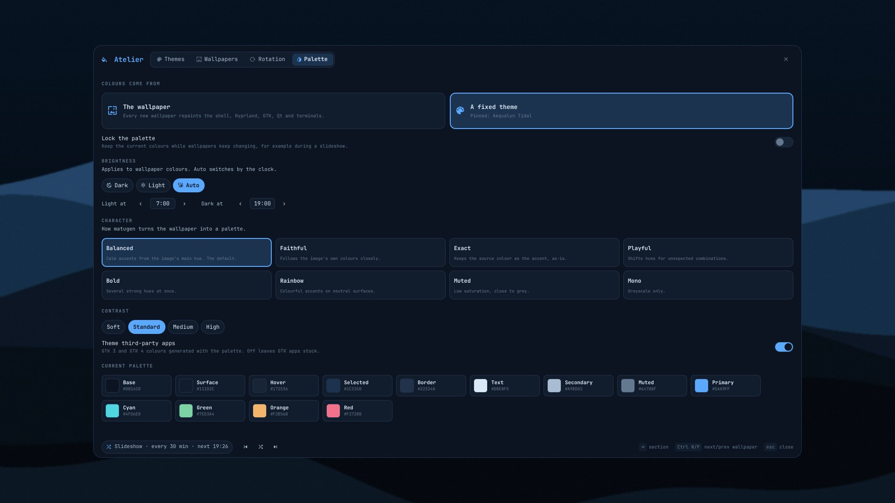 |

## Bar and docks

The bar is painted behind its widgets and the docks are painted by the same
engine (`style/`), so they can wear one look or each their own. Looks come in
five families (Calm, Isles, Pebbles, Glow, Crafted); an ensemble dresses the
bar and every dock in one click. Right-click any dock to open Atelier on it.

| Bar tab | Docks tab |
| --- | --- |
| 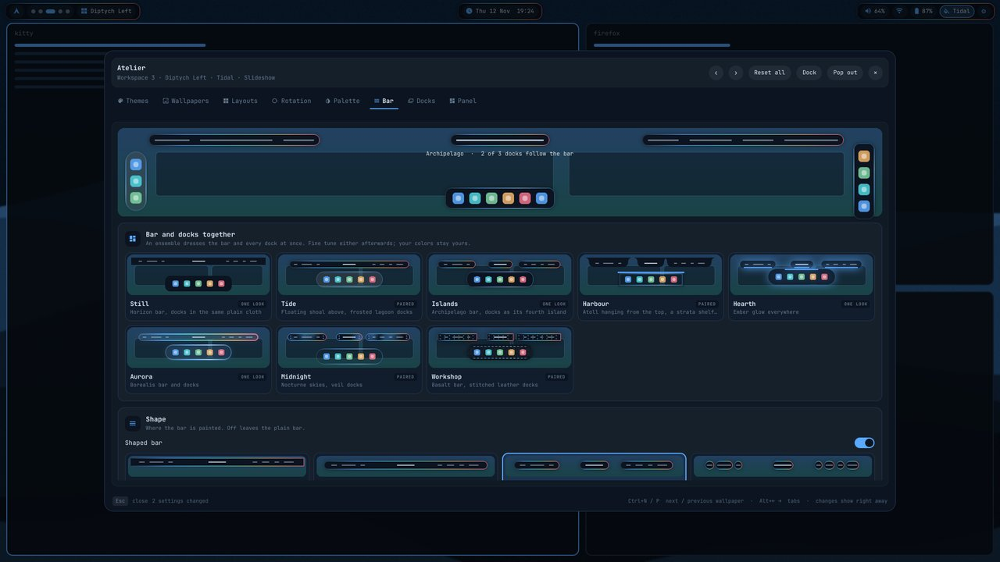 | 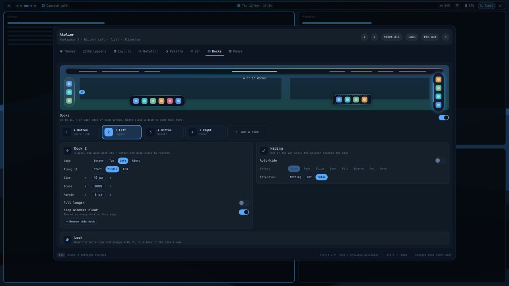 |
| 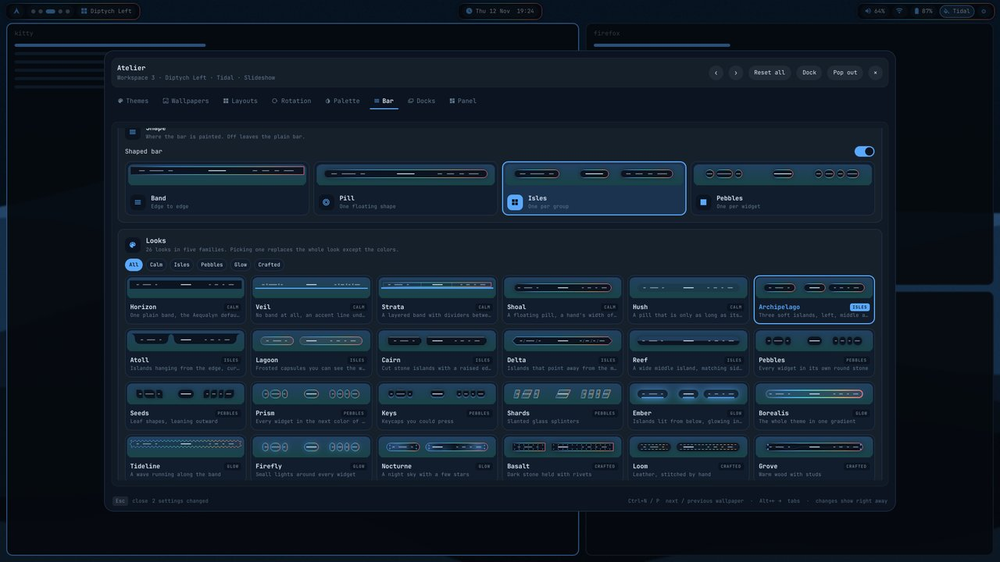 | 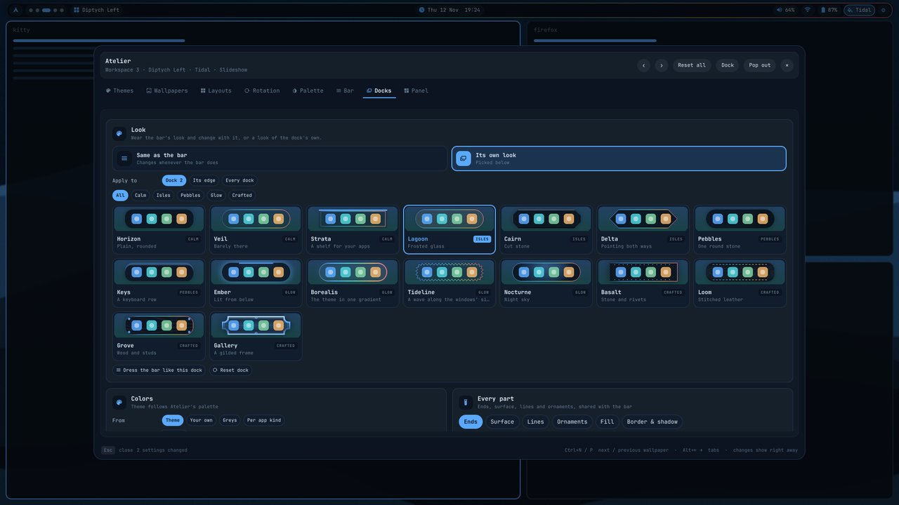 |
| **Tide ensemble** | **16 docks** |
| 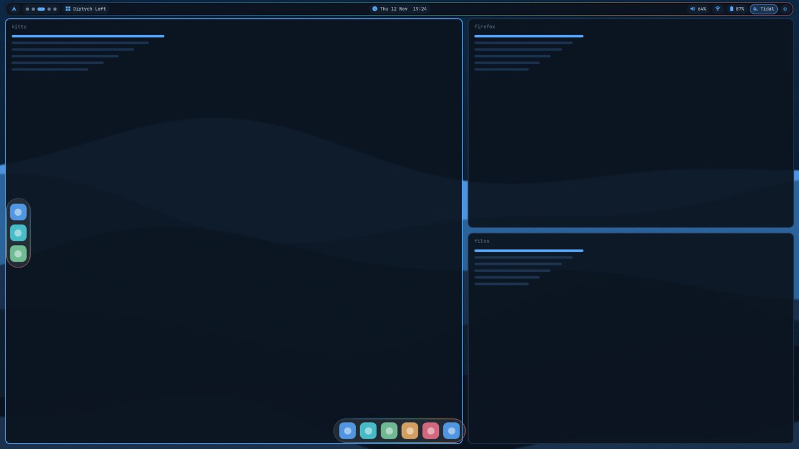 | 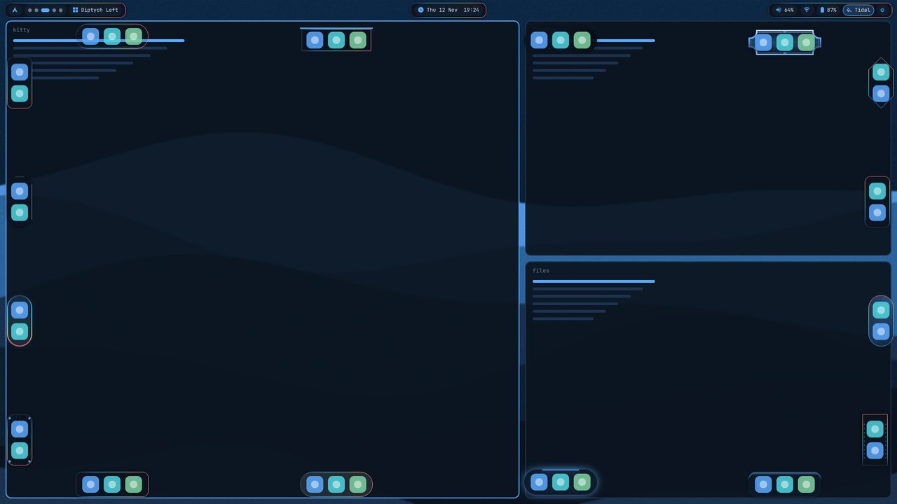 |

Settings: `settings.json` → `barStyle` (checked by `style/BarLooks.js`), and
`~/.config/aequalyn/docks.json` (the first start takes the old `dock` block).

### Keys

| Key | |
| --- | --- |
| `Super + T`, `Super + Ctrl + Shift + Space` | Open on Themes |
| `Super + W` | Open on Wallpapers |
| `Super + Shift + W` | Open on Rotation |
| `Super + Alt + L` | Open on Layouts |
| `Super + Ctrl + Space` | Next wallpaper (no picker) |
| Arrows, PgUp / PgDn | Move |
| `Enter` / `Shift + Enter` | Apply and close / apply and keep browsing |
| Typing | Search |
| `Tab` / `Shift + Tab` | Next / previous collection |
| `Ctrl + 1…6`, `Ctrl + L` | Pick / cycle layout |
| `Ctrl + N` / `Ctrl + P` / `Ctrl + R` | Next / previous / random wallpaper |
| `Esc` | Clear search, then close |

### IPC

```sh
qs ipc call atelier toggle themes        # themes | wallpapers | layouts | rotation | palette | bar | docks | panel
qs ipc call atelier layout radial        # grid | carousel | filmstrip | radial | list | spotlight
qs ipc call wallpaper next               # prev | random | set <file> | mode <mode>
qs ipc call theme set tidal              # folder theme id, "Family/Name" or palette index
qs ipc call theme follow                 # colours follow the wallpaper again
qs ipc call dock add                     # toggle | show | hide | add | settings <n>
```

### Adding a layout

A layout is one file in `atelier/layouts/` taking `theme`, `font`, `items`
and `currentIndex`, exposing `columns` (for Up / Down) and emitting
`hovered(index)` and `picked(index)`. Add it to `layouts/qmldir`, to the
switch in `Atelier.qml` and to `LayoutPicker.qml`.

## Layout

```
shell.qml          entry point, shares the palette as ts.theme
atelier/           Atelier picker, AtelierService, layouts/, controls/, Bar and Docks tabs
style/             the painter shared by bar and docks, AequalynLooks.js (looks, ensembles)
bar/               Bar.qml (shared state, one bar per screen), BarSection.qml (a region that scrolls
                   when full), BarSlot.qml, BarDecor.qml (the shapes behind the widgets),
                   widgets/ (one file per widget, listed in widgets/Widgets.js)
docks/             DocksService.qml (up to 16), DockWindow.qml
theme-switcher/    Theme.qml (palette engine), curated themes.json, matugen glue
settings/          AequalynSettings.qml (settings.json contract), Settings.qml
app-launcher/ notifications/ osd/ clipboard/ power-menu/
monitor-manager/ bluetooth/ idle-inhibitor/
```

## Tests

```sh
node tests/looks.test.js     # every look, dock look, ensemble and bar shape
```

## Run from a checkout

```sh
qs -p .            # or: ln -s "$PWD" ~/.config/quickshell && qs -n -d
```

## Credits

[nightdevil00](https://github.com/nightdevil00) contributed to the code here.

## License

This project is licensed under the GNU General Public License v3.0 (GPL-3.0).
See [LICENSE](LICENSE) for the full text.
